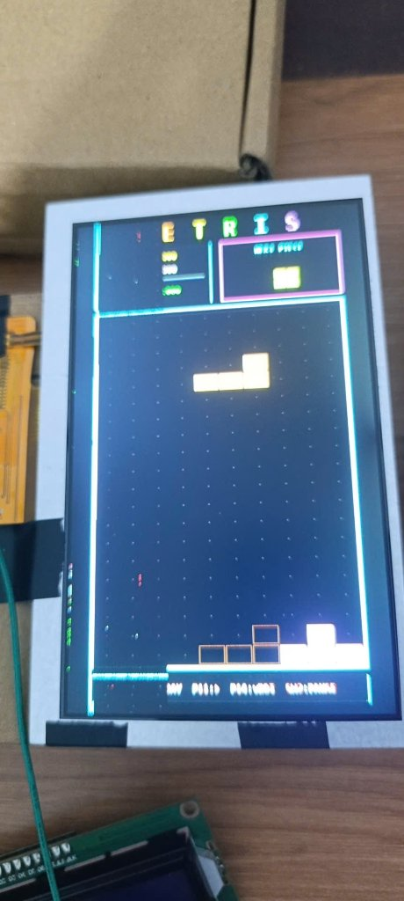
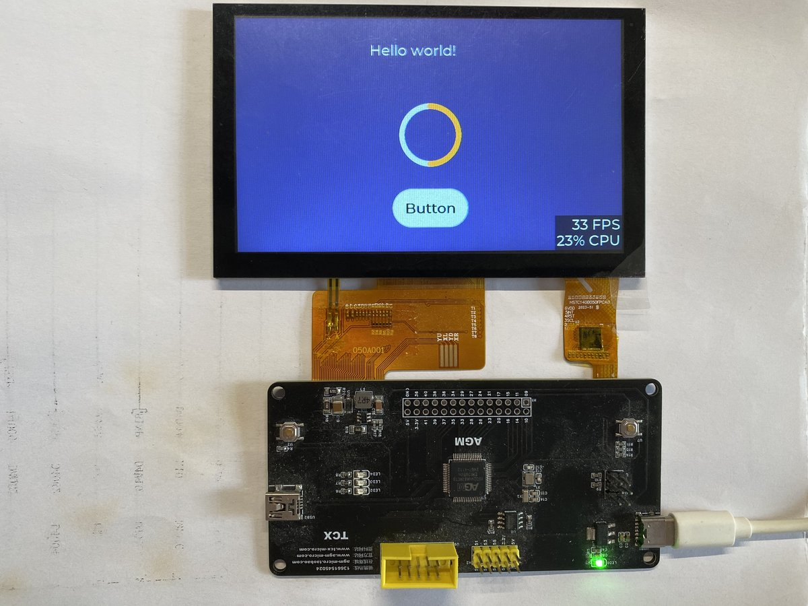

# Tetris Arcade on AGM AG32 (AG32VH407 / AGRV2KL64H)

[](https://platformio.org/)
[](https://www.alta-gate.com)
[](docs/ARCHITECTURE.md)
[](LICENSE)
[](https://github.com/Tien550/Tetris-base-AG32VH407/actions)

A complete, high-performance arcade Tetris game running on the **AGM AG32VH407 / AG32VF407** heterogeneous SoC (custom **"TCX" Board**), driving a **5.0" 800×480 24-bit RGB TFT LCD (ST7262)** at **60 FPS** with **Zero CPU display refresh overhead** and **4 external arcade tactile buttons**.

---

## 📸 Hardware & In-Game Showcase

<p align="center">
  
  &nbsp;&nbsp;
  
</p>

---

## ✨ Key Features & Engineering Highlights

* **Heterogeneous SoC Co-Design**: Combines a **32-bit RISC-V core (150 MHz)**, an embedded **2K LE CPLD logic fabric**, and **8 MB SiP HyperRAM** within a single LQFP-64 chip.
* **Zero-CPU Video Refresh Pipeline**: 
  * A continuous **Circular DMA** engine in CPLD streams the 768 KB framebuffer from HyperRAM (`0x60000000`) through an asynchronous 64-byte FIFO to the 24-bit RGB panel at ~60 FPS.
  * The CPU is 100% liberated from display timing generation and frame scanning.
* **Portrait Mode ($480 \times 800$) with $180^\circ$ Rotation**:
  * Seamless mathematical coordinate mapping ($px = y, py = 479 - x$) for upright vertical arcade gaming.
* **ST7262 Gate-Driver Artifact Mitigation (56 px Safe Margin)**:
  * Solved hardware scanline smearing on physical panel rows 440–479 (adjacent to the FPC connector) by establishing an engineered $56\text{ px}$ lateral safe zone ($X \in [56, 424]$).
* **Instant Lockout Debounce Engine (35 ms)**:
  * **0 ms latency**: Registers button presses on the very first microsecond of mechanical switch contact, followed by a 35 ms bounce lockout.
* **Auto-Polarity Baseline Detection**:
  * Automatically samples pin voltages at boot. Supports both **Active-Low** (Pull-Up to 3.3V, button to GND) and **Active-High** (Pull-Down, button to 3.3V) configurations without code recompilation.
* **Full-Featured Retro Arcade Tetris Engine**:
  * **Standard 7-Bag Randomizer** (prevents drought streaks).
  * **SRS Wall-Kick** piece rotation system.
  * **Ghost Piece Projection** for precise drop targeting.
  * **Animated Line Clear Flash**, progressive drop speeds by level, and modal Pause / Game Over dialogs.
  * **Live On-Screen Button Status Bar**: Real-time indicators `[9 10 11 14 SW]` glow gold on screen when buttons are pressed.

---

## 🛠️ Hardware Specifications

| Component | Specification | Description |
|---|---|---|
| **MCU** | AGM AG32VH407RCT6 / AGRV2KL64H | 32-bit RISC-V Core @ 150 MHz (LQFP-64) |
| **Logic** | Alta-Gate CPLD Matrix (~2000 LUTs) | RGB timing generator & HyperRAM DMA FIFO |
| **Video Memory** | 8 MB SiP HyperRAM (`0x60000000`) | Dedicated 768 KB RGB565 Framebuffer |
| **Internal Flash** | 256 KB Flash | Program (`0x80000000`) + Bitstream (`0x80034000`) |
| **Internal SRAM** | 128 KB SRAM | Zero-wait-state system memory |
| **External Flash** | 2 MB SPI Flash (W25Q16JV) | Splash images and persistent assets |
| **Display Panel** | 5.0" TFT LCD (`0500A013-S110100`) | 800×480 resolution, 24-bit RGB parallel, ST7262 IC |
| **User Inputs** | 4 External Pushbuttons + 1 Onboard SW2 | Left, Rotate, Right, Drop + Pause/Restart |
| **Debug & Logs** | CMSIS-DAP OpenOCD / DAP-Link | High-speed SWD flashing + UART0 log (115200 8N1) |

---

## 🔌 Pinout & Connection Guide

### External Pushbuttons (Header H1)
Connect 4 tactile pushbuttons between the following pins of Header H1 and Ground:

| Button | Header H1 Pin | AGM MCU Pin | Function |
|---|---|---|---|
| **MOVE LEFT** | **Pin 1** | `PIN_9` (`GPIO2_0`) | Shift tetromino left |
| **ROTATE** | **Pin 2** | `PIN_10` (`GPIO2_1`) | Rotate piece clockwise (Wall-kick enabled) |
| **MOVE RIGHT** | **Pin 3** | `PIN_11` (`GPIO2_2`) | Shift tetromino right |
| **HARD DROP** | **Pin 4** | `PIN_14` (`GPIO2_3`) | Instantly drop tetromino to bottom |
| **GND** | **Pin 23/24** or Board GND | `GND` | Common ground reference |

### Onboard Controls & Indicators
| Component | Physical Pin | Function |
|---|---|---|
| **SW2 Button** | `PIN_51` (`GPIO6_2`) | Pause Game / Restart after Game Over |
| **LED L2** | `PIN_54` (`GPIO4_1`) | Panic / Hardware Trap Indicator (blinks @ 100ms on fault) |
| **LED L3** | `PIN_53` (`GPIO4_2`) | Heartbeat status indicator |
| **LED L4** | `PIN_52` (`GPIO4_3`) | DMA stream active indicator |
| **UART0 TX** | `PIN_43` (`USART0_TX`) | Serial log output (115200 8N1) |

> 📖 *For complete pinout mappings including LCD RGB bus and schematics, refer to [docs/PINOUT.md](docs/PINOUT.md) and [docs/hardware/SCH_AGRV2KL64H_2025-02-15_schematic.pdf](docs/hardware/SCH_AGRV2KL64H_2025-02-15_schematic.pdf).*

---

## 🏗️ System Architecture

```mermaid
flowchart TD
    subgraph SoC ["AGM AG32VH407 Heterogeneous SoC"]
        CPU["RISC-V 32-bit Core (150 MHz)"]
        SRAM["128 KB Internal SRAM"]
        HRAM["8 MB SiP HyperRAM (0x60000000)\nFramebuffer (768 KB)"]
        
        subgraph CPLD ["Embedded CPLD Logic (~2K LE)"]
            HRAM_IP["HyperBus Memory Controller (hram_ip.v)"]
            FIFO["64-Byte Dual-Clock FIFO"]
            RGB_TIMING["ST7262 Timing Engine (fifo2rgb.v)\n- DCLK (25 MHz)\n- HSYNC, VSYNC, DE"]
        end
    end
    
    LCD["5.0\" RGB LCD 800x480 (ST7262)"]
    BUTTONS["Arcade Pushbuttons (H1 Pins 1-4)"]
    
    CPU -->|Write Pixels / Shapes| HRAM
    BUTTONS -->|Lockout Debounce (35ms)| CPU
    HRAM <-->|150 MHz Burst| HRAM_IP
    HRAM_IP -->|Circular DMA Refresh| FIFO
    FIFO --> RGB_TIMING
    RGB_TIMING -->|16-bit Parallel RGB| LCD
```

> 📖 *For full hardware-software co-design details, see [docs/ARCHITECTURE.md](docs/ARCHITECTURE.md).*

---

## 🚀 Quick Start & Building

### 1. Prerequisites
* **Operating System**: Windows 10/11 (64-bit).
* **PlatformIO Core**: [Install PlatformIO CLI or VS Code extension](https://platformio.org/).
* **Debug Probe**: CMSIS-DAP / DAP-Link connected via USB.

### 2. Compile & Flash Firmware
```powershell
# Clone the repository
git clone https://github.com/Tien550/Tetris-base-AG32VH407.git
cd Tetris-base-AG32VH407

# Flash both CPLD bitstream and game firmware
.\flash_all.bat
```
*(Or use `pio run -e debug -t upload` to flash firmware only).*

### 3. Monitor Serial Debug Log
```powershell
pio device monitor -b 115200
```

> 📖 *For full instructions on synthesizing CPLD logic with Intel Quartus II, check [docs/BUILD_GUIDE.md](docs/BUILD_GUIDE.md).*

---

## 📂 Repository Structure

```
Tetris-base-AG32VH407/
├── .github/workflows/ci.yml # GitHub Actions CI static analysis & integrity pipeline
├── docs/
│   ├── ARCHITECTURE.md      # Detailed SoC & video pipeline architecture
│   ├── PINOUT.md            # Hardware pin mappings and wiring diagram
│   ├── BUILD_GUIDE.md       # Firmware & CPLD synthesis guide
│   ├── hardware/            # Official board schematic PDF & pinout diagrams
│   └── images/              # High-resolution board & running display photos
├── logic/                   # CPLD Verilog HDL & synthesis scripts
│   ├── fifo2rgb.v           # 800x480 LCD timing & FIFO controller
│   ├── hram_ip.v            # Top-level HyperBus memory interface
│   ├── rgb.ve               # Pin constraint file for AG32 LQFP-64
│   └── hram_ip/hram_ip.vx   # Pre-synthesized netlist (no Quartus required to build!)
├── src/
│   ├── main.c               # System initialization & trap handler
│   ├── board_hw.c/h         # BSP: LED, SW2, 4-button instant debounce & auto-polarity
│   ├── drivers/lcd/         # HyperRAM & LCD RGB DMA drivers
│   ├── drivers/flash/       # W25Q16JV SPI flash driver
│   └── games/tetris/        # Full Tetris engine, SRS wall-kick, fonts & renderers
├── tools/
│   ├── img2rgb565.py        # Python tool to convert images to 800x480 RGB565
│   └── send_image.ps1       # PowerShell script to stream frames over UART0
├── flash_all.bat            # One-click flash for both logic & firmware
├── platformio.ini           # PlatformIO project configuration
├── .gitignore               # Strict ignore rules for build caches & temp files
├── LICENSE                  # MIT License
└── README.md                # Project documentation
```

---

## 🎮 Game Controls

| Action | Control | Visual Indicator on LCD |
|---|---|---|
| **Move Left** | Header H1 Pin 1 (`PIN_9`) | `[9]` illuminates gold |
| **Rotate** | Header H1 Pin 2 (`PIN_10`) | `[10]` illuminates gold |
| **Move Right** | Header H1 Pin 3 (`PIN_11`) | `[11]` illuminates gold |
| **Hard Drop** | Header H1 Pin 4 (`PIN_14`) | `[14]` illuminates gold |
| **Pause / Resume** | Onboard Button `SW2` (`PIN_51`) | `[SW]` illuminates gold |
| **Restart (on Game Over)** | Onboard Button `SW2` (`PIN_51`) | Restarts board and score |

---

## 📄 License

This project is licensed under the **MIT License** — see the [LICENSE](LICENSE) file for details.

Developed with ❤️ by **[Tien550](https://github.com/Tien550)**.

